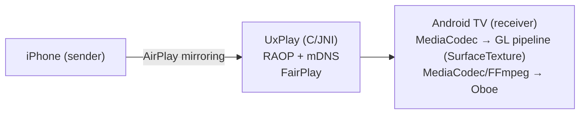

# AirPlay TV

AirPlay TV turns an Android TV into an AirPlay receiver with one job: mirroring an iPhone screen to the TV to watch movies on the big screen. Start a film in any app on the iPhone, open Control Center, choose Screen Mirroring and pick the TV: the picture fills the screen without the phone's black bars, motion stays steady and the sound stays in sync.

It is a fork of [android-airplay-server](https://github.com/jqssun/android-airplay-server), built on the [UxPlay](https://github.com/FDH2/UxPlay) AirPlay library.

## Features

- **Screen mirroring** (H.264; H.265 is off by default because some TV decoders show a black screen with it) with AAC-ELD audio.
- **Black-bar crop** (`auto_crop`, on by default): the GL pipeline samples a tiny copy of the frame every 300 ms, finds the black bars the phone adds around the movie and scales the rest to fill the TV. Only black is removed, and a new crop has to stay stable for a while, so dark scenes don't zoom the picture.
- **Smooth playback with lip-sync** (`smooth_playback`, on by default): compressed frames are queued and decoded just in time for the sender's presentation timestamp plus a delay, instead of on arrival. The delay follows the measured audio presentation delay, so lips stay in sync; `av_offset_ms` fine-tunes it. While mirroring, a low-latency Wi-Fi lock keeps the radio out of power save.
- **Remote that can't end the movie by accident**: Back, OK and the D-pad only bring up the overlay; stopping from the TV needs an explicit confirmation.
- **Audio-only mode**: AirPlay music (AAC, ALAC) with track info, cover art, playback controls and Android media session.
- **Who can connect**: optional PIN, a prompt the first time a new device connects, and a list of allowed devices. While a device is mirroring, other Apple devices are told the TV is busy; the same device can reconnect at once (for example after a Wi-Fi drop).
- **Settings over ADB** for TVs without an easy way to type (see below).

> [!WARNING]
> DRM content (e.g. the Apple TV app) is not supported: iOS refuses to mirror it.

Requires Android 6.0 (API 23) or newer; built and tested for Android TV / Google TV. The TV and the iPhone must be on the same network.

## What changed from upstream

This fork removes everything that isn't mirroring a movie:

- **AirPlay Video (HLS URL handoff) is gone and never advertised.** With it, iOS stops mirroring when a video starts and hands the TV a stream URL instead. Many video apps serve that stream from a proxy on the phone itself (`http://127.0.0.1:…`), which the TV can't reach, so the session dropped. Without it, iOS keeps mirroring and the movie plays.
- Also removed: video downloads, Picture-in-Picture, the USB-tethering secondary display, and the settings that only served those.
- Added: black-bar crop, smooth playback with lip-sync, the TV interface (Spanish by default, English included), the connection prompt and allowed devices, and the same-device reconnect described above (UxPlay patch `0010`).

## Settings over ADB

Settings can be changed with a broadcast. The receiver is protected by `android.permission.DUMP`, so only `adb shell` (not other apps) can use it. Values are passed as text with `--es`. From `adb shell`:

```bash
KEY="server_name" VALUE="Living room"
am broadcast -n app.airplaytv/io.github.jqssun.airplay.SettingsReceiver -a io.github.jqssun.airplay.SET_SETTING --es key "$KEY" --es value "$VALUE"
```

To list every setting with its current value and default as JSON (start the app once first so it can receive broadcasts):

```bash
am start -n app.airplaytv/io.github.jqssun.airplay.MainActivity
am broadcast -n app.airplaytv/io.github.jqssun.airplay.SettingsReceiver -a io.github.jqssun.airplay.LIST_SETTINGS
```

Useful keys: `auto_crop`, `smooth_playback`, `av_offset_ms` (-500..500, positive = picture later), `h265` (`auto`/`on`/`off`), `allow_new_conn` (`true` lets any new device take over), `request_new_devices`, `require_pin`, `resolution`, `max_fps`, `debug_enabled`, `benchmark_log`.

## How it works

UxPlay (C) implements the AirPlay/RAOP protocol, pairing and FairPlay; a JNI bridge connects it to the Android app, which advertises the TV over mDNS. Mirrored video is decoded by MediaCodec into a SurfaceTexture and drawn by a GL pipeline (black-bar crop, aspect fit) onto the screen. Audio is decoded by MediaCodec or FFmpeg (software ALAC/AAC) and played through Oboe.



## Building

Native code (UxPlay, OpenSSL, FFmpeg, libplist) is built with CMake from [`app/src/main/cpp`](app/src/main/cpp); UxPlay is patched at build time with the patches in [`app/src/main/cpp/patches/UxPlay`](app/src/main/cpp/patches/UxPlay). You need the Android SDK, NDK 27.0.12077973 and JDK 17 or newer.

```bash
git submodule update --init --recursive
./gradlew assembleRelease
```

> [!NOTE]
> The native build fails if the project path contains spaces: clone it into a path without them.

## Credits

- [android-airplay-server](https://github.com/jqssun/android-airplay-server) by jqssun, the upstream app this fork is based on
- [UxPlay](https://github.com/FDH2/UxPlay) for the AirPlay/RAOP server implementation
- [FFmpeg](https://ffmpeg.org) for the software ALAC and AAC decoders

Licensed under the GPLv3, see [LICENSE](LICENSE).

---

Disclaimer: This project is not affiliated with Apple Inc.
